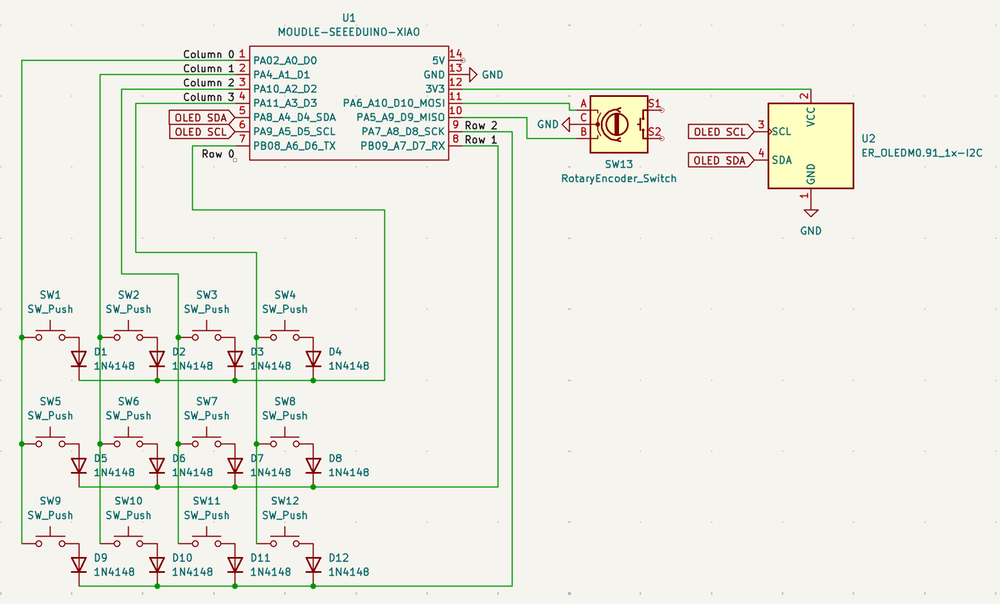
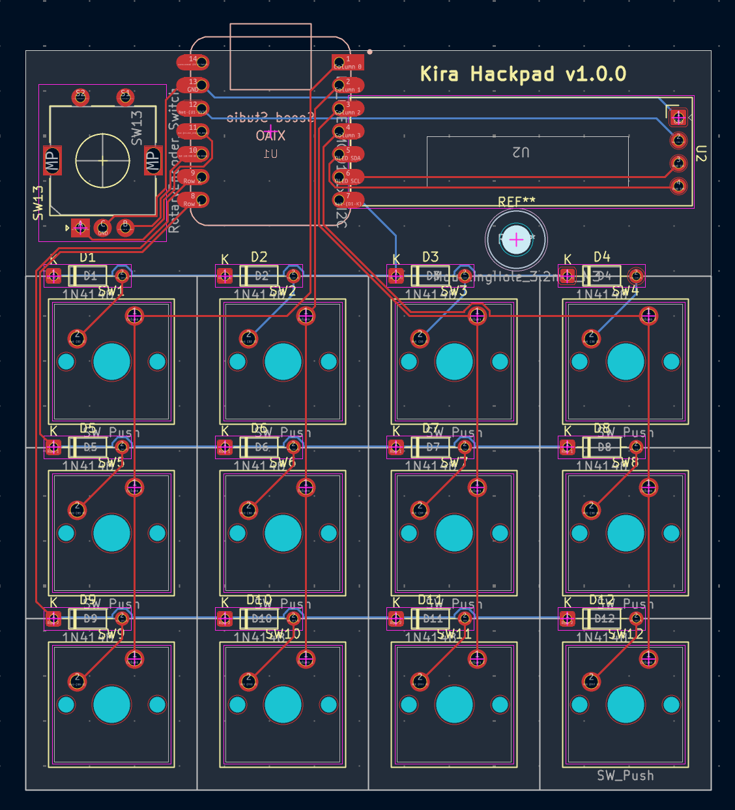
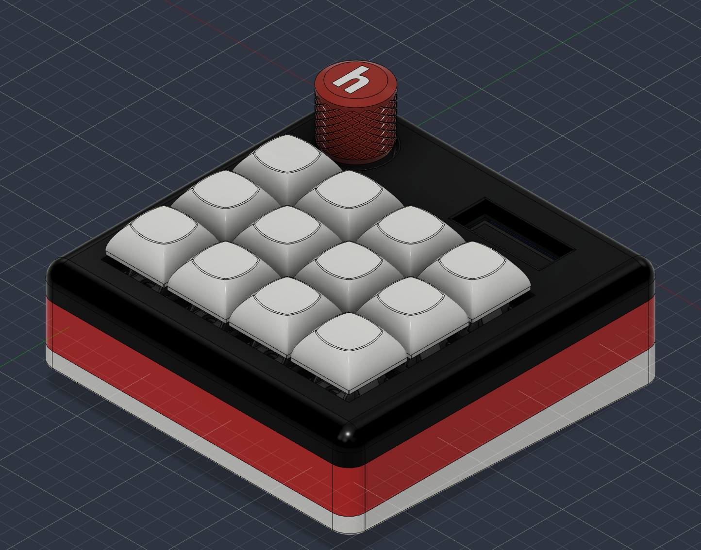

# Kira Hackpad

A 12-key custom macropad with a rotary encoder and a little OLED screen, built from scratch - PCB, case, and firmware.

## Features

- 12 keys in a 4x3 grid
- Rotary encoder for volume
- 0.91" OLED display for status
- Runs on a Seeed XIAO RP2040
- QMK firmware

## Hardware

- Controller: Seeed XIAO RP2040
- Switches: 12x Cherry MX
- Diodes: 12x 1N4148
- Encoder: EC11 rotary encoder
- Display: 0.91" SSD1306 OLED (128x32)

## PCB

Designed in KiCad. It's a simple 2-layer board - a 2x4 switch matrix with per-key diodes, XIOA footprint, encoder, and OLED. Source files are in ['pcb/'](pcb/) (schematic, layout, and STEP export).

## Case

Designed in Fusion 360, in three printed parts: the angle, the base where the PCB sits, and the top cover. They fits together using 5 M3 bolts and heatset inserts - 4 cor the case and one for the PCB. The design is in ['cad/'](cad/).

## Firmware

Written with QMK and lives in ['firmware/'](firmware/). The keys are laid out for editing + media shortcuts, the encoder controls volume, and OLED shows a status readout. A ready-to-flash `firmware.uf2` is in ['production/'](production/).

### Keymap

| | | |
|-|-|-|
| Undo | Redo  | Cut  | Prev |
| Copy | Paste | Save | Play |
| All  | Find  | Mute | Next |

Encoder: turn = Volume Down / Up

"Undo", "Redo", "Cut", "Prev", "Copy", "Paste", "Save", "Play", "Select All", and "Find" are sent as **Ctrl+key**, which works on Windows. On macOS remap them to `G(...)` (Cmd) in `keymaps/default/keymap.c`.

### Flash

To flash: put the XIAO RP2040 into bootloader mode (double-tap RESET or hold BOOT while plugging in). It appears as a USB drive - copy `firmware.utf2` onto it. The board reboots into the firmware.

### Customizing

- Keys - edit the `LAYOUT(...)` block in `keymaps/default/keymap.c`.
- Encoder - edit the `encoder_map` in the same file.
- OLED text - edit `oled_task_user()` in the same file.

## Built with

- KiCad (PCB)
- Fusion 360 (case)
- QMK (firmware)

## BOM (Bill of Materials)

## Bill of Materials

The complete itemized parts list is in **[`BOM.csv`](BOM.csv)**.

Prices are indicative per-unit estimates or previously observed listings, not verified live checkout prices. Shipping, tax, supplier pack sizes, PCB manufacturing minimums, and 3D-printing quotes are excluded.

| Component | Qty | Unit price (USD) | Extended cost (USD) | Purchase/source |
|---|---:|---:|---:|---|
| Seeed Studio XIAO RP2040 | 1 | $3.99 | $3.99 | [Link](https://www.seeedstudio.com/XIAO-RP2040-v1-0-p-5026.html) |
| 0.91 inch SSD1306 OLED display 128x32 I2C | 1 | $3.73 | $3.73 | [Link](https://www.robotshop.com/products/091-inch-128x32-i2c-oled-display-blue) |
| EC11 rotary encoder | 1 | $1.50 | $1.50 | [Link](https://www.aliexpress.com/w/wholesale-ec11-rotary-encoder.html) |
| MX-style mechanical switches | 12 | $0.40 | $4.80 | [Link](https://www.aliexpress.com/w/wholesale-mx-mechanical-switch.html) |
| Blank DSA keycaps white | 12 | $0.60 | $7.20 | [Link](https://www.aliexpress.com/w/wholesale-blank-dsa-keycaps.html) |
| M3 x 16 mm screws | 4 | $0.15 | $0.60 | [Link](https://www.mcmaster.com/products/socket-head-screws/thread-size~m3/) |
| M3 x 12 mm screw | 1 | $0.15 | $0.15 | [Link](https://www.mcmaster.com/products/socket-head-screws/thread-size~m3/) |
| M3 x 5 x 4 mm heat-set inserts | 5 | $0.25 | $1.25 | [Link](https://www.aliexpress.com/w/wholesale-m3-heat-set-insert.html) |
| 1N4148 through-hole diodes | 12 | $0.10 | $1.20 | [Link](https://www.digikey.com/en/products/result?keywords=1N4148) |
| 3D-printed case (3 parts) | 1 | $3.00 | $3.00 | [CAD files](cad/) |
| Custom hackpad PCB | 1 | $2.00 | $2.00 | [Link](https://jlcpcb.com/) |
| **Estimated total** | | | **$29.42** | |

**Pricing note:** Several links lead to product searches, not exact purchasable variants. The PCB $2.00 and printed case $3.00 are allowances, not supplier quotes.

### Hack Club Grants

I used/received the following Hack Club grants during the project:

* **Hackpad Kit!** - Hackpad kit containing parts for the project
* **Printing Legion Grant** - $8 shipping credit for a part under 300g
* **Soldering Iron Grant** - $18 grant toward a soldering iron
* **Hackpad PCB Grant** - $10 JLCPCB credit for the Hackpad PCB

## Inspiration

It was was created using guide from Hack Club's Stardance program as a starting point. It was also inspired by [Orpheuspad](https://github.com/qcoral/orpheuspad) and the wider custom hackpad community. Thanks for sharing your bilds!

## Author

Made with ❤️ by [@kira-iovenko](https://github.com/kira-iovenko)
